# dartcv architecture

For the color-based multi-dart work, start with
[resuming development](#resuming-color-based-multi-dart-development), then read
the [agreed design](#agreed-color-based-multi-dart-design). These sections preserve
the decisions from the design interview; continuing does not require access to
the original conversation.

## Purpose and scope

dartcv estimates a planar dartboard's geometry in a photograph, draws the board
model, and rectifies the image. It also provides point-scoring helpers and
synthetic board rendering. It does not currently locate dart tips automatically
or implement a complete live scoring application.

## Components and responsibilities

| Component | Responsibility | Interfaces and dependencies |
| --- | --- | --- |
| [cli](../src/dartcv/cli.py) | Argument parsing, image loading, calibration mode selection, batch iteration, output writing | `main()`, `pick_points()`; calls detection, geometry, overlays, and diagnostics |
| [detect](../src/dartcv/detect.py) | Automatic homography estimation and optional diagnostic capture | `detect_board()` returns `Detection`; uses geometry, overlay transforms, and ring refinement |
| [rings](../src/dartcv/rings.py) | Full-resolution paint-band sampling, common geometry refinement, independent edge fits | `refine_coloured_rings()` returns a homography and `RingBoundary` mapping; uses SciPy optimization |
| [geometry](../src/dartcv/geometry.py) | Millimetre model, calibration, projection, contour-radius queries, point scoring | `RADII`, `SECTORS`, `compute_homography()`, `project()`, scoring helpers; NumPy/OpenCV |
| [edge detection](../src/dartcv/edge_detection.py) | General-purpose Canny edges from grayscale or BGR uint8 images | `canny_edges()`; grayscale conversion, Gaussian smoothing, and OpenCV Canny |
| [overlay](../src/dartcv/overlay.py) | Source-image overlays and top-down warping, optionally using fitted paint contours | `draw_overlay()`, `warp_topdown()`, `topdown_overlay()`; geometry and OpenCV |
| [diagnostics](../src/dartcv/diagnostics.py) | Visual explanations of detection and supplied calibration | `detection_overlays()`, `calibration_overlay()`; consumes detector results |
| [board](../src/dartcv/board.py) | Synthetic visualization in normalized coordinates | Rendering helpers used by the [example notebook](../examples/dartboard_visualization.ipynb); not the detector's metric model |
| [recognition](../src/dartcv/recognition.py) | Recognition data contracts, output validation, backend execution, expected-sector comparison | `DartBox`, `NumberReading`, `DartTip`, `StageResult`, `run_stage()`, validators, `expected_sector()`; no bundled inference backend |
| [recognition overlay](../src/dartcv/recognition_overlay.py) | Draw observed boxes, text, tips, and optional scores without mutating the source | `annotate()`; consumes recognition records, uses OpenCV |
| [dart detection](../src/dartcv/dart_detection.py) | Optional local pretrained, text-guided whole-dart box experiment | `Owlv2DartDetector(image)` returns `DartBox` records; lazy PyTorch/Transformers loading, processor coordinate restoration, OpenCV NMS |
| [classical darts](../src/dartcv/classical_darts.py) | Calibrated, single-dart flight/shaft hypothesis generation, conservative acceptance and diagnostics | `ClassicalDartDetector(H)(image)` returns zero/one `DartBox`; `diagnostic_views()`; NumPy/OpenCV only |
| [dartboard darts pipeline](../src/dartcv/dartboard_dart_pipeline.py) | Skeleton for the multi-dart board-recognition pipeline: stage registration, debug images, per-step timing, and modular replacement points | `DartboardDartRecognitionPipeline()` stores `PipelineResult.steps`, `board_mask`, `dart_mask`, and `timings_ms`; each stage keeps input/output images for inspection |
| [color-based dart pipeline](../src/dartcv/color_dart_pipeline.py) | Separate, incrementally implemented pipeline for board-aware multi-dart scoring | `ColorBasedDartRecognitionPipeline` uses typed replaceable stages; currently implements board localization and normalized-board warping, with later stages injected |
| [color-dart inspection](../src/dartcv/color_dart_inspection.py) | Explicit geometry overlays and board/orientation visualization | `draw_board_geometry()` returns a copied BGR image; `plot_board_preparation()` and `plot_orientation()` return Matplotlib figures without display or file I/O |
| [color-dart orientation](../src/dartcv/color_dart_orientation.py) | Board-style-specific printed-20 template matching on an optional wider rectification | `Printed20OrientationStage(template)`, `extract_printed20_template()`, `unwrap_number_ring()`; NumPy/OpenCV, no OCR, downloads or image I/O |
| [board-inspection notebook](../examples/color_dart_board_inspection.ipynb) | Selected multi-dart photo inspection, detector-artifact views, optional resolution comparison | Calls `prepare_board()` without unfinished recognition stages; presents diagnostics and timings |
| [orientation-inspection notebook](../examples/color_dart_orientation_inspection.ipynb) | Explicit reference-template extraction, selected-photo matching and coverage/annotation inspection | Uses the small manual orientation manifest and optional number-ring normalizer; does not change the existing board-inspection notebook |
| [recognition notebook](../examples/dart_recognition.ipynb) | Staged single-image orchestration, configuration, plotting, scoring, optional export | Defaults to classical boxes with session reuse keyed by settings/calibration; OWLv2 remains an optional library alternative; number and tip slots remain unset |

## Runtime and data flow

```mermaid
flowchart TD
    CLI[CLI: load BGR image] --> Mode{Calibration mode}
    Mode -->|automatic| Detect[Detector: ellipse, bull, rotation, ECC]
    Detect --> Rings[Colour-ring refinement]
    Rings --> Result[Detection: H, contours, optional diagnostics]
    Mode -->|manual or supplied points| Geometry[Four-point homography]
    Result --> Render[Source and top-down overlays]
    Geometry --> Render
    Result --> Debug[Pipeline diagnostics]
    Geometry --> Calib[Supplied-point diagnostic]
    Render --> Write[CLI: write PNG outputs]
    Debug --> Write
    Calib --> Write
```



The console entry point is `dartcv.cli:main`. An explicit file writes directly
to the selected output directory; a directory writes per-image subdirectories.
Manual calibration uses an OpenCV window; supplied points bypass the window.
Library detection returns data without writing files. See the
[README](../README.md) for CLI options and output names.

The color-based multi-dart pipeline is a separate library entry point, not an
extension of the earlier `DartboardDartRecognitionPipeline` skeleton. It accepts
one in-memory BGR image, detects and normalizes the board, then invokes injected
orientation, segmentation, entry-point, and scoring stages. Those injections
are required; an explicit-template orientation implementation is available, but
segmentation, entry-point localization and new scoring remain unimplemented.
The pipeline does not fabricate results for them.
`prepare_board()` runs only the shared localization/normalization prefix and
returns a `BoardPreparationResult`, so these stages can be inspected independently.
The complete pipeline calls the same function rather than maintaining a second
execution path. Expected failures retain completed steps and skip dependents.

## Contracts and invariants

- Images are OpenCV BGR arrays. Image points are `(x, y)` in pixels.
- The geometry model uses millimetres, with origin at the bull, x right and y
  down. Angles increase clockwise from the centre of sector 20 at the top.
- `H` maps model millimetres to original-image pixels, not the reverse.
  Point scoring uses its inverse. Top-down warping uses
  `model_to_topdown() @ inverse(H)`.
- `Detection.H_initial` is the initial bull-constrained, rotated estimate before
  ECC and ring refinement. `Detection.H` is the final mapping. Diagnostic arrays
  can use different resolutions; their dataclass fields document their frames.
- `Detection.rings` contains fitted contours in original-image pixels. Overlay
  code transforms these for top-down rendering; absent contours remain nominal.
- `ColorBasedDartRecognitionPipeline` uses the board-model-to-source homography
  to create a configurable square view with the board diameter filling the
  canvas. Its run result keeps source-image board-entry coordinates; optional
  diagnostics contain copied stage artifacts, while timings are always returned.
  The scoring-board image excludes the printed-number ring. The optional
  `NormalizedBoardView.number_ring: NumberRingView | None` retains a separate
  wider image, model-to-view transform and source-coverage mask. Request it with
  `partial(normalize_board_view, number_ring_radius_mm=240.0)` as the injected
  normalizer. It uses the same output size but a wider physical extent, without
  changing any scoring-view image/mask/transform. The default does no extra warp.
  Inspection overlays show nominal rings/spokes, not detected wires or numbered
  sector identities. Timing summaries sum stage execution durations and exclude
  file loading, artifact snapshot copies, and visualization.
- Scoring uses nominal `RADII`, not the fitted paint contours. The normalized
  synthetic renderer is not a replacement for the millimetre geometry model.
- Recognition backends return original-image coordinates and confidence in [0, 1].
  `run_stage()` distinguishes missing, failed, and successful-empty results;
  exceptions or validation failures discard all items from that stage. Box IDs
  must be unique; associated tips must refer to a known nearby box. A box centre
  is never substituted for a tip, and expected sector labels never replace OCR.
- Supplied calibration points must be the outer-double intersections at
  `20|1`, `6|10`, `3|19`, `11|14`, in that order.

## Design decisions and trade-offs

- Coarse image segmentation provides a geometric seed, while original-resolution
  bull and paint measurements retain fine spatial information.
- A planar homography describes shared board geometry; independent paint edges
  allow real band widths to differ from nominal wire-based dimensions.
- Optional refinement stages retain usable estimates when measurements are
  unreliable. A successful return is not a guarantee of correct orientation or
  scoring accuracy. See the [pipeline](cv-pipeline.md) for acceptance and fallback rules.
- Detection, geometry, rendering, and file orchestration have separate modules;
  diagnostics explain results without defining the detector's objective.
- The color-based multi-dart pipeline deliberately owns separate scoring
  contracts and board constants; see [ADR 0001](adr/0001-separate-color-dart-pipeline.md).

### Agreed color-based multi-dart design

**Status recorded 2026-10-25:** milestones 1, 2 and 3 are implemented. Everything
marked planned below is a design commitment, not an available recognition
algorithm. Develop and inspect one module at a time rather than deliver the
entire recognizer in one change.

The goal is robust automatic localization and point counting from a single
photograph of a standard 20-sector steel-tip board. Dart bodies may overlap or
extend outside the board; entry points are assumed not to overlap. The expected
dart count is a positive per-run setting, defaulting to three. Priorities are
understandable intermediate outputs, replaceable modules, and measured speed.
There is no committed real-time/video target or numerical latency budget yet.

The color-based idea is based on
[Dart detection with HSV colour classes](../examples/dartboard_dart_detection_algorithm.pdf):
model normal board colors and find anomalous pixels belonging to darts.
Red, green, beige, and black board fields form four color classes; shadows and
lighting variation need robust modeling. Metal wires/reflections can resemble
metal dart parts, so color outliers alone are insufficient. Do not copy the
PDF's bull-dependent board-localization approach: reuse `detect_board()` instead.

| Stage | Current state | Agreed responsibility / future implementation |
| --- | --- | --- |
| Board localization | Implemented | Replaceable `detect_board_stage()` adapter to `detect_board()`; board-model millimetres map to original-image pixels. It supplies geometry, not a physical wire segmentation. |
| Normalization | Implemented | `normalize_board_view()` retains transforms and a nominal board mask; configurable square output, default 1024 px across the scoring board. Optional wider number-ring view retains source coverage; original-image access remains available. |
| Numbered-sector orientation | Implemented initial template matcher; injected stage required | `Printed20OrientationStage(template)` identifies the printed `20` after perspective correction. Explicit board-style template, best alignment, heuristic match strength and trustworthy/uncertain flag. Weak/cropped/obscured evidence can fail or return an uncertain, potentially wrong best guess. |
| Board-color modeling and dart segmentation | Planned; injected stage required | Derive field masks from board geometry/alignment, fit four robust per-image color distributions, exclude expected wires, and produce a normalized-board dart-likelihood map. |
| Board-entry-point localization | Planned; injected stage required | Separate non-overlapping entry points even if dart bodies form merged blobs. Return estimates in original-image pixels with confidence/provenance, not box centers. |
| Scoring | Planned; injected stage required | Independently map board-entry points to sector/ring/points; preserve best guesses and explicit uncertainty. Existing scoring helpers are not the new implementation. |

**Modularity and execution:** use typed injected callables/objects with explicit
stage outcomes, not an inheritance/plugin registry framework. Preserve the
earlier `DartboardDartRecognitionPipeline` rather than replace it. The new
pipeline owns independent types, stage helpers, board constants/sector ordering,
and future scoring math; sharing the existing detector is intentional.
The standard geometry constants are already present in `color_dart_pipeline.py`;
score mapping is not. Avoid silently coupling it back to `recognition.DartTip`
or the existing scorers.

**Orientation is not just perspective correction:** alternating ring colors
repeat every 36 degrees and cannot uniquely identify sector 20.
`detector_rotation_deg` is not verified numbered-sector alignment. An unreadable
`20` should not silently become a confident upright-board assumption. Preserve a
best-guess alignment/score with orientation uncertainty when evidence supports
a guess; missing localization evidence still permits an unknown result.

Milestone 3 keeps the existing `OrientationStage(board_view, *, diagnostics)`
contract. Its optional wider view covers a 240 mm radius by notebook default;
matching unwraps radii 194–236 mm into 85 radial rows and 1440 angular columns
(four samples per degree), clockwise from -180 degrees with the outer edge at
row zero. These radii fit the inspected board, not every board manufacturer's
number ring. Source coverage is propagated separately from image brightness;
partially missing template windows cannot supply matches.

The template is an explicit BGR patch extracted from a **manually identified**
reference `20`, with a default 14-degree width and radii 202–228 mm.
`extract_printed20_template()` checks coverage; the stage caches local-contrast
template features at scales 0.9/1.0/1.1. At runtime it unwraps the number ring,
subtracts local Gaussian brightness, performs normalized correlation, and ranks
up to five hypotheses separated by at least 18 degrees. Matching crosses the
360-degree seam; it is not restricted to the detector's initial upright guess.
The reference template is caller supplied: the library reads no images/files
and bundles no general-purpose font/OCR model.

Provisional defaults: correlation below 0.25 means no supported match; otherwise
retain the best guess. Set `confident=True` only at strength >=0.65 and a gap
>=0.10 from the next distinct candidate. Strength is **not a probability** and
these thresholds have not been calibrated across boards. Occluded labels can
select a different numeral: do not use an uncertain guess as verified alignment.
`correction_deg` is the negative of the matched clockwise label angle, wrapped
to [-180, 180), so it describes a **clockwise** correction in the rectified
model. OpenCV's affine-rotation helper uses the opposite sign. No image or
homography is silently rotated; downstream segmentation/scoring must apply this
estimate consistently when they are implemented.

With diagnostics enabled, orientation returns the wider input and its model
transform, number strip and coverage, template, angular response, and candidate
`[clockwise_angle_deg, correlation]` rows. `plot_orientation()` marks the best
label without claiming to detect physical wires. Internal timings separate
unwrapping from matching; normalizer execution includes the optional wider warp,
while template reference loading/preparation is caller-owned setup, not hidden
per-photo work.

**Required orientation fallback (planned, not yet implemented):** when a dart
fully or partially covers `20` and its match is unreliable, identify a visible
neighboring `5` or `1` and derive the 20-sector position from the standard sector
order. With angles clockwise from model top, `angle_20 = angle_5 + 18 degrees`
or `angle_20 = angle_1 - 18 degrees`, wrapped consistently. If both neighbors
are available, check that their derived positions agree; conflicting or weak
evidence must remain explicitly uncertain rather than force a confident result.
Expose which label supported the estimate in diagnostics and cover full/partial
20 occlusion in focused tests. The current matcher does not provide this fallback.

**Color-model sampling:** pool interior pixels only from geometry-identified
fields of the corresponding color, giving four per-image distributions, not one
model over all board pixels or separate distributions for every field. Apply
the expected field-color model in that field. Exclude wire margins and robustly
reject contaminated samples such as darts. How to fit distributions, handle
low sample support, model HSV hue wrapping/features, and set outlier thresholds
is not yet implemented or fixed by the interview.

**Metal suppression:** start with geometry-derived expected wire regions plus
edge/small-component cleanup; keep this replaceable inside segmentation.
Do not assume `detect_board()` returns physical wires, and do not treat metal
as a fifth ordinary board-color class. The PDF-inspired operations include HSV
features, robust outlier classification, edge-preserving filtering, morphology
and local regrowth, minimum-component filtering, hole filling, and optional
GrabCut refinement. These are candidate internal operations, not a requirement
to run every operation or expose each as a top-level pipeline stage.
Expose internal named artifacts/substep timings as those operations are added.

**Board-entry and score semantics:**

- The target is the board-entry/contact point, not the visible metal tip end,
  dart body center, or bounding-box center. A hidden contact may be inferred from
  geometrically constrained shaft/barrel evidence; mark it inferred/uncertain.
  Insufficient evidence yields an unknown point, never a fabricated location.
- Return one slot per expected dart. Order localized points by source `(x, y)`,
  then unresolved slots. This is single-image ordering, not persistent tracking.
- A score estimate includes sector, scoring ring/multiplier, and total points.
  Boundary ambiguity retains a best guess plus uncertainty, rather than forcing
  certainty or discarding every guess. The board-space boundary margin is
  configurable (currently 2.5 mm) and must be calibrated on labeled photos.
- Allow multiple concurrent uncertainty reasons: inferred/unknown entry,
  orientation, score boundary, or unavailable score. A confidently localized
  entry outside the scoring surface is a `MISS` worth zero; an unknown entry
  has no score. Do not substitute zero for missing evidence.
- Aggregate all expected score estimates only when every expected slot has one;
  otherwise omit the total. Preserve total completeness and uncertainty flags
  independently: a complete best-guess total can still be uncertain.
- Initially focus on board-associated darts; do not add a general detector to
  find objects wholly outside the board. Such a dart may remain unresolved.
  Preserve original-image access so off-board evidence is not irretrievably
  cropped away.

**Observability and failures:** accept one non-empty BGR `uint8` NumPy image per
run; the caller handles loading and color conversion. Return structured timing
data on every run and a pure `format_timing_summary()` string formatter. Store
diagnostics per run rather than mutable latest-run state on the pipeline.
Diagnostic capture is opt-in, with named input/output array snapshots; no
automatic windows, file writes, or printing. Injected stages must not mutate
inputs. Expected algorithm failures produce explicit partial results and skip
dependent stages, preserving completed information; unexpected exceptions
propagate. Required unfinished stages must be injected, not represented by
success-shaped placeholders.

### Resuming color-based multi-dart development

1. Read this section, the design above, the [glossary](../GLOSSARY.md), and
   [ADR 0001](adr/0001-separate-color-dart-pipeline.md). Check `git status` before
   editing: substantial unrelated staged/unstaged work may be present. Do not
   revert, stage, or commit that work implicitly. **Commit progress after each
   completed stage**, including its related documentation, once verified.
   The initial checkpoint includes all then-staged work with explicit user
   approval; that approval does not extend to unrelated changes in later stages.
2. **Milestone 1, done:** separate contracts/orchestration, real board-localization
   adapter and normalization, injected future stages, partial failures,
   per-dart/aggregate result shape, timings, and optional diagnostic snapshots.
   Start at [color_dart_pipeline.py](../src/dartcv/color_dart_pipeline.py).
3. **Milestone 2, done:** board-only `prepare_board()` uses the same prefix as the
   full pipeline. [color_dart_inspection.py](../src/dartcv/color_dart_inspection.py)
   draws nominal geometry and returns a six-panel figure; it does not display
   or save automatically. Open
   [color_dart_board_inspection.ipynb](../examples/color_dart_board_inspection.ipynb)
   using the project environment (`uv sync --group dev`), select `IMAGE_INDEX`,
   and rerun from **Run preparation**. Inspect rings, bull, spokes, detector/ECC
   artifacts and timings. Resolution comparison is explicitly opt-in.
4. **Milestone 3, done:** optional wider view and source coverage, explicit
   reference-template extraction, replaceable `Printed20OrientationStage`,
   candidate/response diagnostics and substep timings. Open
   [color_dart_orientation_inspection.ipynb](../examples/color_dart_orientation_inspection.ipynb).
   Run setup/reference once, then change `IMAGE_INDEX` and rerun from selection.
   Index 1 has a visible `20`; index 0 is obscured and returns an uncertain,
   wrong best guess. The original board-inspection notebook is unchanged.
   Inject both its `NORMALIZER` and `ORIENTATION_STAGE` into the full pipeline
   when real downstream stages become available.
   **Outstanding orientation follow-up:** implement the `5`/`1` fallback above
   for a fully or partially dart-covered `20`.
5. **Next milestone:** implement geometry-derived field-interior masks, same-color sampling, robust
   color models, and dart-likelihood segmentation. Keep wire/metal cleanup
   replaceable and expose its internal diagnostic/timing evidence.
6. Then implement entry-point localization and independent scoring incrementally.
   Their algorithm details remain open; apply the agreed uncertainty, miss,
   ordering, and aggregate contracts rather than inventing new semantics.

The small [orientation manifest](../data/annotations/color_dart_orientation.json)
records one template reference, two visible-label checks with approximate
manually inspected source-image centers, and one occluded-label check.
The centers were visually selected independently of the matcher, with an
estimated 24 px uncertainty. This is a same-board development fixture, not an
accuracy benchmark; the reference is not counted as validation. Ground-truth
board geometry, dart entries and scores remain unannotated. Extend annotations
as each later module needs them. Keep the imagery local/DVC-managed and do not publish photo metadata or
embed the full dataset into notebooks. Update this status and the relevant
contracts/limitations after each milestone so the next session can resume
without rediscovering the design.

## Dependencies, data, and artifacts

[Project metadata](../pyproject.toml) defines Python support, dependencies, the
console script, and the `uv_build` backend. NumPy/OpenCV support image geometry;
SciPy supports robust ring optimization; Matplotlib supports synthetic rendering.
DVC with Google Drive support manages the image dataset; its authentication
dependencies are not part of the detection algorithm.

The `dart-detection` extra adds PyTorch, Torchvision, Transformers, and Pillow.
The optional adapter is independent of board calibration and preserves original
perspective. Its first inference loads pinned external weights into a local
Hugging Face cache; imports and synthetic tests never fetch weights. Images stay
local. Core board commands do not require these dependencies.

The classical detector needs no additional dependencies. It consumes the board
homography as a search/paint prior, never as a warp of the dart. Its last-attempt
diagnostics store working-resolution arrays with an explicit source scale;
returned boxes use original pixels. It has no file-writing or scoring side effects.

Image contents are managed as one DVC dataset, referenced by
[data/images.dvc](../data/images.dvc). Output images are generated artifacts,
not input data. Credentials stay local and must not enter documentation or Git.
See the [README data workflow](../README.md#pictures-on-google-drive-uv--dvc).

The multi-dart input directory is **`data/images/multi_dart`**, not
`data/multi_dart`. At the 2026-10-25 inspection it contained 17 real JPEG photos,
each 6144 by 8160 pixels, with no annotation sidecars. Boards are visible in the
photos, with overlap/cropping and varying label visibility; do not infer exact
dart counts or ground-truth scores from this inventory. Full-resolution
diagnostic copies are memory-heavy, so the notebook retains only the selected
run and downsizes display previews, not processing inputs.

## Validation and limitations

- [Homography tests](../tests/test_homography.py) cover synthetic projection,
  scoring, detection, CLI outputs, diagnostics, and bull constraints.
- [Ring tests](../tests/test_rings.py) cover colour-band fitting, refinement,
  occlusion/fallback behavior, and overlay integration.
- [Edge-detection tests](../tests/test_edge_detection.py) cover grayscale/BGR
  inputs, output shape/type, input immutability, and parameter validation.
- [Recognition tests](../tests/test_recognition.py) cover backend states, output
  validation, tip associations, sector comparison, and non-mutating annotation.
- [Classical dart tests](../tests/test_classical_darts.py) cover synthetic flights,
  shafts, paint rejection, ambiguity, hue wrapping and coordinate restoration.
- [Color pipeline tests](../tests/test_color_dart_pipeline.py) cover board
  normalization, stage injection, partial failures, optional diagnostics, and
  per-run timing/result contracts, plus headless inspection rendering, BGR/RGB
  display conversion, and non-mutating geometry overlays. They do not establish
  dart-recognition accuracy.
- [Orientation tests](../tests/test_color_dart_orientation.py) cover unchanged
  scoring views, wider-view source coverage, signed rotation/seam handling,
  perspective, missing/cropped evidence, duplicate-label ambiguity, pipeline
  wiring and non-mutating headless visualization. Three annotated same-board
  photo checks run when the optional DVC-managed inputs are present; otherwise
  that test skips.
- Run `uv run --group dev pytest`; use one explicitly selected real image for a
  visual check unless a batch evaluation is requested.
- Synthetic tests and diagnostic fit residuals do not establish real-dataset
  accuracy. Colour dependence, occlusion, orientation ambiguity, and nominal
  scoring boundaries remain important limitations.

### Recorded development checks (2026-10-25)

Milestone 1's real-photo smoke run returned board localization and normalized
views on all 17 multi-dart images. Mean board-detection time was approximately
0.92 seconds per full-resolution image on that development machine. This is a
single exploratory run, not a performance guarantee or verification that all
homographies are geometrically correct.

For milestone 2, the board-inspection notebook's code cells were executed on
`PXL_20261018_154231645.jpg`, including its optional 512/1024/1536 px comparison;
the six-panel output was rendered and inspected. The targeted pipeline and
homography command passed 40 tests:

```bash
uv run --group dev pytest -q tests/test_color_dart_pipeline.py tests/test_homography.py
```

For milestone 3, the orientation notebook was executed headlessly on
`PXL_20261018_154237729.jpg` using the explicit reference
`PXL_20261018_154400079.jpg`; its four-panel figure was rendered and inspected.
The visible label matched confidently at a clockwise correction of 0.25 degrees
(approximately 0.23 degrees from the manually inspected source center).
The other visible annotated photo also matched within the 2-degree tolerance;
the obscured-label photo returned an uncertain, wrong candidate, as documented.
The targeted command passed 55 tests:

```bash
uv run --group dev pytest -q tests/test_color_dart_orientation.py tests/test_color_dart_pipeline.py tests/test_homography.py
```

An exploratory notebook run measured approximately 1.1 ms to unwrap and 7.5 ms
to match at the default 1024 px normalization, excluding reference preparation,
board detection, I/O and rendering. These are development observations, not
latency guarantees or broad orientation accuracy measurements.

No accuracy claims for segmentation, entry-point localization, or new scoring
follow from these checks: those algorithms remain unimplemented.
Benchmark stage execution with diagnostics off and repeated representative
inputs before choosing a latency target. Compare geometric quality as well as
runtime; fast, successful execution is not sufficient evidence of correctness.

## Related documentation and maintenance

- [README](../README.md): commands, outputs, setup, and data workflows.
- [CV pipeline](cv-pipeline.md): algorithm stages, frames, acceptance rules,
  diagnostics, and technical limitations.
- [Glossary](../GLOSSARY.md): canonical board-entry/orientation/field terminology.
- [Separate color-pipeline ADR](adr/0001-separate-color-dart-pipeline.md):
  rationale for independent contracts and scoring geometry.
- [Architecture template](templates/architecture.md): required structure for this
  document; update both when that structure changes.

Update this document when module boundaries, dependencies, interfaces, data flow,
or contracts change. Keep detailed algorithm parameters in the pipeline document
and code rather than duplicating them here.