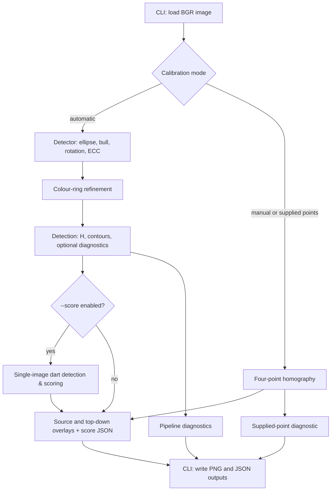

# dartcv architecture

## Purpose and scope

dartcv estimates a planar dartboard's geometry in a photograph, draws the board
model, rectifies the image, and automatically detects and scores darts in single
images. It also provides an interactive ground-truth annotation and inspection
web application, a quantitative evaluation harness, and synthetic board
rendering. It does not implement a continuous multi-camera live video tracking
application.

## Components and responsibilities

| Component | Responsibility | Interfaces and dependencies |
| --- | --- | --- |
| [cli](../src/dartcv/cli.py) | Argument parsing, image loading, calibration mode selection, batch iteration, output writing | `main()`, `pick_points()`; calls detection, geometry, overlays, and diagnostics |
| [detect](../src/dartcv/detect.py) | Automatic homography estimation, dart scoring pipeline, and optional diagnostic capture | `detect_board()`, `analyze_image()`; uses geometry, overlay transforms, and ring refinement |
| [darts](../src/dartcv/darts.py) | Candidate detection, shaft axis extraction, tip localization, and score computation | `detect_darts()`; returns `DartDetection` list and `DartDiagnostics` |
| [types](../src/dartcv/types.py) | Shared data structures for board pose, dart localization, and turn analysis | `DartDetection`, `DartDiagnostics`, `BoardAnalysis` |
| [rings](../src/dartcv/rings.py) | Full-resolution paint-band sampling, common geometry refinement, independent edge fits | `refine_coloured_rings()` returns a homography and `RingBoundary` mapping; uses NumPy optimization |
| [geometry](../src/dartcv/geometry.py) | Millimetre model, calibration, projection, contour-radius queries, point scoring | `RADII`, `SECTORS`, `compute_homography()`, `project()`, scoring helpers; NumPy/OpenCV |
| [overlay](../src/dartcv/overlay.py) | Source-image overlays and top-down warping, optionally using fitted paint contours | `draw_overlay()`, `warp_topdown()`, `topdown_overlay()`; geometry and OpenCV |
| [diagnostics](../src/dartcv/diagnostics.py) | Visual explanations of detection and supplied calibration | `detection_overlays()`, `calibration_overlay()`; consumes detector results |
| [annotate](../src/dartcv/annotate.py) | Interactive web-based and GUI annotation tool and evaluation dashboard | `main()`, `run_web_annotator()`, `export_standalone_dashboard()`; provides pan/zoom, loupe, real-time score calculation, dual-tab dashboard UI, and unseen image analysis |
| [evaluate](../src/dartcv/evaluate.py) | Quantitative and visual evaluation harness benchmarking pipeline against ground truth | `main()`, `evaluate_dataset()`; computes bipartite matching, precision/recall, tip error, and reports |
| [board](../src/dartcv/board.py) | Synthetic visualization in normalized coordinates | Rendering helpers used by the [example notebook](../examples/dartboard_visualization.ipynb); not the detector's metric model |

## Runtime and data flow

The console entry point is `dartcv.cli:main`. An explicit file writes directly
to the selected output directory; a directory writes per-image subdirectories.
Manual calibration uses an OpenCV window; supplied points bypass the window.
Library detection returns data without writing files. See the
[README](../README.md) for CLI options and output names.

## Contracts and invariants

- Images are OpenCV BGR arrays. Image points are `(x, y)` in pixels.
- The geometry model uses millimetres, with origin at the bull, x right and y
  down. Angles increase clockwise from the centre of sector 20 at the top.
- `H` maps model millimetres to original-image pixels, not the reverse.
  Point scoring uses its inverse. Top-down warping uses
  `model_to_topdown() @ inverse(H)`.
- `Detection.H_initial` is the initial bull-constrained, rotated estimate before
  ECC and ring refinement. `Detection.H` is the final mapping. Diagnostic arrays
  can use different resolutions; their dataclass fields document their frames.
- `Detection.rings` contains fitted contours in original-image pixels. Overlay
  code transforms these for top-down rendering; absent contours remain nominal.
- `score_from_model_point()` and `score_from_image_point()` use nominal `RADII`.
  `score_point_detailed()` checks fitted `Detection.rings` boundaries when
  supplied and falls back to nominal `RADII` otherwise. The normalized synthetic
  renderer is not a replacement for the millimetre geometry model.
- Supplied calibration points must be the outer-double intersections at
  `20|1`, `6|10`, `3|19`, `11|14`, in that order.

## Design decisions and trade-offs

- Coarse image segmentation provides a geometric seed, while original-resolution
  bull and paint measurements retain fine spatial information.
- A planar homography describes shared board geometry; independent paint edges
  allow real band widths to differ from nominal wire-based dimensions.
- Optional refinement stages retain usable estimates when measurements are
  unreliable. A successful return is not a guarantee of correct orientation or
  scoring accuracy. See the [pipeline](cv-pipeline.md) for acceptance and fallback rules.
- Detection, geometry, rendering, and file orchestration have separate modules;
  diagnostics explain results without defining the detector's objective.

## Dependencies, data, and artifacts

[Project metadata](../pyproject.toml) defines Python support, dependencies, the
console script, and the `uv_build` backend. NumPy/OpenCV support image geometry;
SciPy supports robust ring optimization; Matplotlib supports synthetic rendering.
DVC with Google Drive support manages the image dataset; its authentication
dependencies are not part of the detection algorithm.

Image contents are managed as one DVC dataset, referenced by
[data/images.dvc](../data/images.dvc). Output images are generated artifacts,
not input data. Credentials stay local and must not enter documentation or Git.
See the [README data workflow](../README.md#pictures-on-google-drive-uv--dvc).

## Validation and limitations

- [Homography tests](../tests/test_homography.py) cover synthetic projection,
  scoring, detection, CLI outputs, diagnostics, and bull constraints.
- [Ring tests](../tests/test_rings.py) cover colour-band fitting, refinement,
  occlusion/fallback behavior, and overlay integration.
- [Dart detection tests](../tests/test_darts.py) cover synthetic clean boards,
  single-dart and multi-dart localization, cast shadows, oblique angles, and
  end-to-end `analyze_image()` execution.
- Run `uv run --group dev pytest`; use one explicitly selected real image for a
  visual check unless a batch evaluation is requested.
- Synthetic tests and diagnostic fit residuals do not establish real-dataset
  accuracy. Real-dataset performance is benchmarked via `dartcv-eval` against
  [`data/annotations/ground_truth.json`](../data/annotations/ground_truth.json).
  Colour dependence, multi-dart occlusion, oblique entry angles, and orientation
  ambiguity remain important limitations.

## Related documentation and maintenance

- [README](../README.md): commands, outputs, setup, and data workflows.
- [CV pipeline](cv-pipeline.md): algorithm stages, frames, acceptance rules, diagnostics, and technical limitations.
- [Ground-Truth Dataset & Evaluation](ground-truth-dataset.md): ground-truth schema, annotation tool, and quantitative evaluation harness.
- [Architecture template](templates/architecture.md): required structure for this document; update both when that structure changes.
- [Agent instructions](../AGENTS.md): documentation review and completion rules.

Update this document when module boundaries, dependencies, interfaces, data flow,
or contracts change. Keep detailed algorithm parameters in the pipeline document
and code rather than duplicating them here.